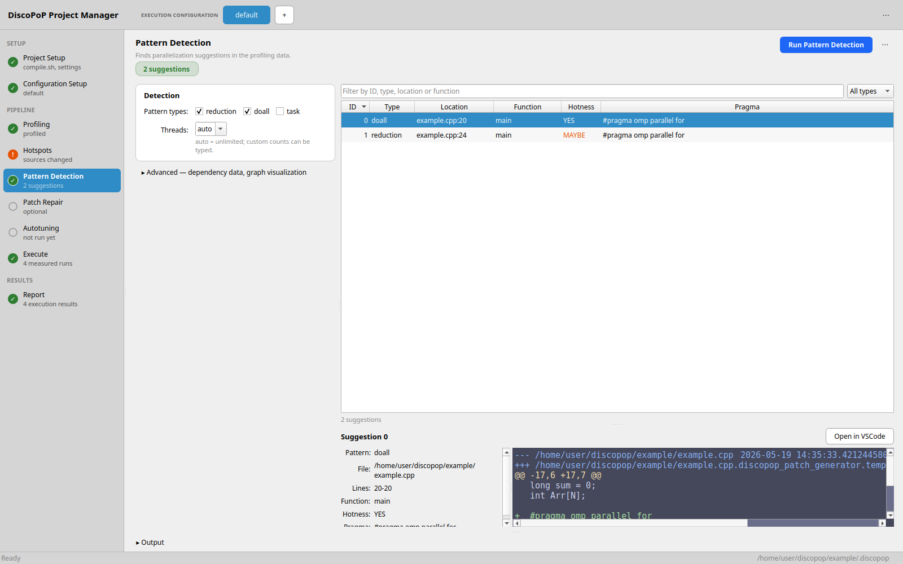

<!--
 /*
 * This file is part of the DiscoPoP software (http://www.discopop.tu-darmstadt.de)
 *
 * Copyright (c) 2020, Technische Universitaet Darmstadt, Germany
 *
 * This software may be modified and distributed under the terms of
 * the 3-Clause BSD License. See the LICENSE file in the package base
 * directory for details.
 *
 */
 -->

# DiscoPoP - Discovery of Potential Parallelism
DiscoPoP is an open-source tool that helps software developers parallelize their programs with threads. It is a joint project of the [High-Performance Computing Lab @ TU Darmstadt](https://github.com/tuda-hpclab) and the [Software Analytics and Pervasive Parallelism Lab](https://www.cs.iastate.edu/swapp/) at Iowa State University.

In a nutshell, DiscoPoP performs the following steps:
* detect parts of the code (computational units or CUs) with little to no internal parallelization potential,
* find data dependences among them,
* identify parallel patterns that can be used to parallelize a code region,
* and finally, suggest corresponding OpenMP parallelization constructs and clauses to programmers.

A more comprehensive overview of DiscoPoP can be found on our [project website](https://www.discopop.tu-darmstadt.de/).

## Prerequisites
You need Python 3.11 or newer, LLVM/clang 19-22 with development files, CMake 3.28 or newer, a C++20 compiler, the Boost headers, and Tk with a display for the GUI. The profiler is built during the installation.

On Debian and Ubuntu:
```bash
sudo apt install python3 python3-pip python3-venv python3-tk build-essential cmake git llvm-19-dev clang-19 clang-tools-19 libclang-19-dev libomp-19-dev libboost-dev
```
`libclang-19-dev` is optional: it makes the instrumentation of template heavy projects much faster. Replace 19 with 20, 21, or 22 for a newer LLVM release. Ubuntu 24.04 packages LLVM 19 and 20, Debian 13 packages 19 and 22; other versions are available from [apt.llvm.org](https://apt.llvm.org).

For Arch-based distributions (`pacman`) and macOS (Homebrew), see the [installation page](https://tuda-hpclab.github.io/discopop/setup/discopop/). These routes are not tested in CI.

## Installation
```bash
python3 -m venv venv
source venv/bin/activate
pip install discopop
```
To install from a checkout of this repository, see the [installation page](https://tuda-hpclab.github.io/discopop/setup/discopop/).

## Starting the GUI
Your project has to build with the compilers and flags given in `$CC`/`$CXX` and `$CFLAGS`/`$CXXFLAGS`. Start the GUI in the project directory:
```bash
cd <your project>
discopop_gui
```
On the first start, a wizard asks for your compile script and an execution script, and creates the first configuration. See [Getting started](https://tuda-hpclab.github.io/discopop/getting_started/) for the details.

## What the GUI can do
Detect parallel patterns: the Execute tab manages the profiling and the Pattern Detection tab analyzes the profiling data of your program in order to identify and present parallelization suggestions in the form of OpenMP constructs and corresponding patches.



Find the combination that pays off: the Autotuning tab measures combinations of the suggestions on your program and shows the speedup of each.


## Documentation
* [Getting started](https://tuda-hpclab.github.io/discopop/getting_started/): install DiscoPoP and work through the GUI.
* [Manual](https://tuda-hpclab.github.io/discopop/manual/): installation options, examples, all tools and the data they produce.
* [MCP server](https://tuda-hpclab.github.io/discopop/tools/MCP_server/): lets AI assistants run DiscoPoP.
* [VS Code extension](https://tuda-hpclab.github.io/discopop/setup/vscx/): an extension to the GUI for browsing suggestions in the editor.

## Contact
In case any issues arise, please contact us via GitHub messages or by mail to [discopop-support@lists.parallel.informatik.tu-darmstadt.de](mailto:discopop-support@lists.parallel.informatik.tu-darmstadt.de).

## License
© DiscoPoP is available under the terms of the BSD-3-Clause license, as specified in the LICENSE file.
