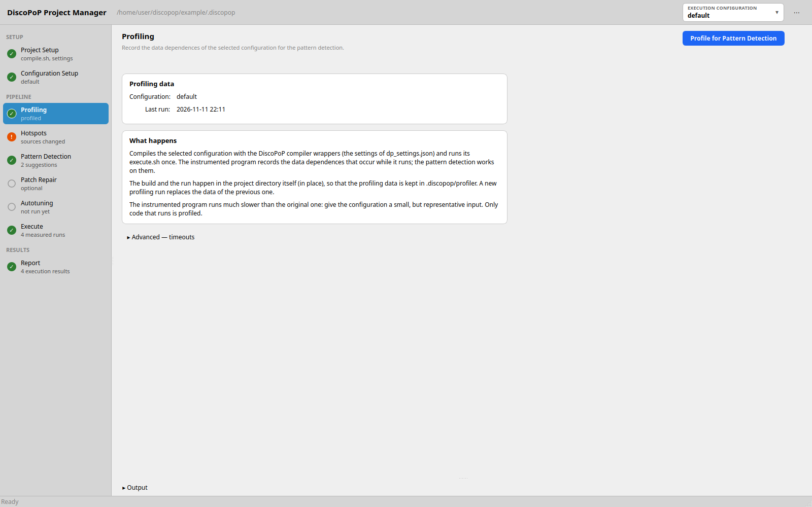
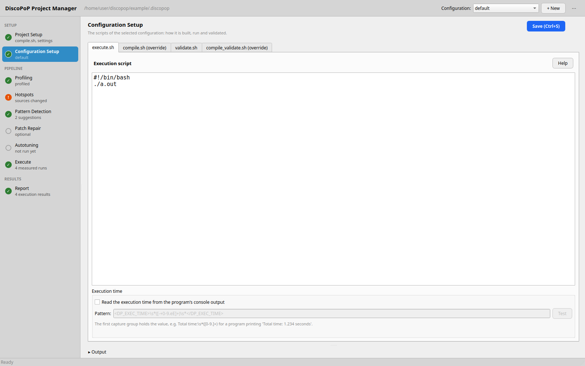
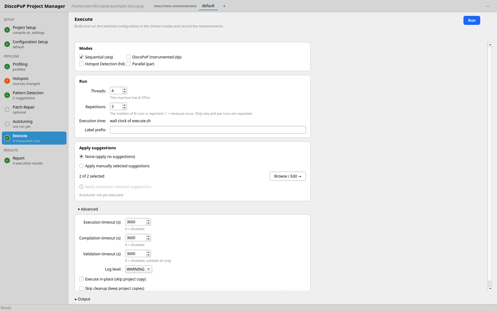
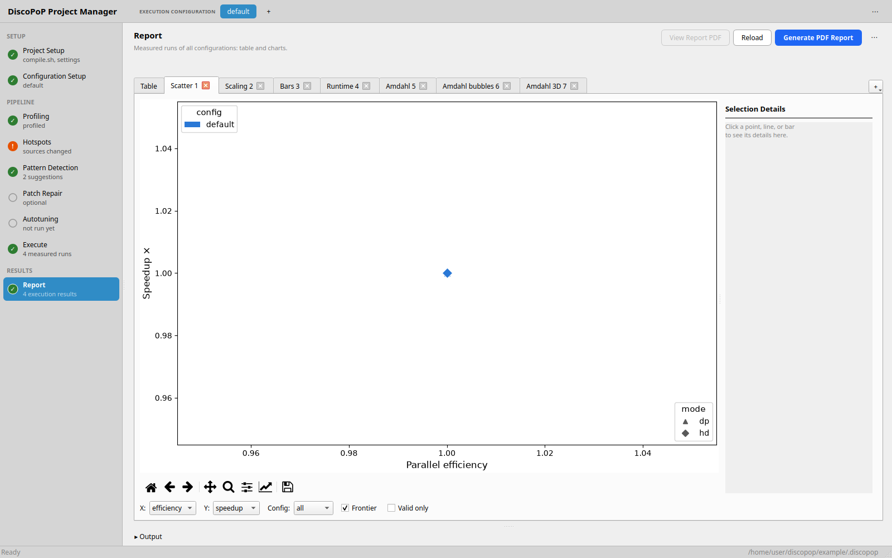
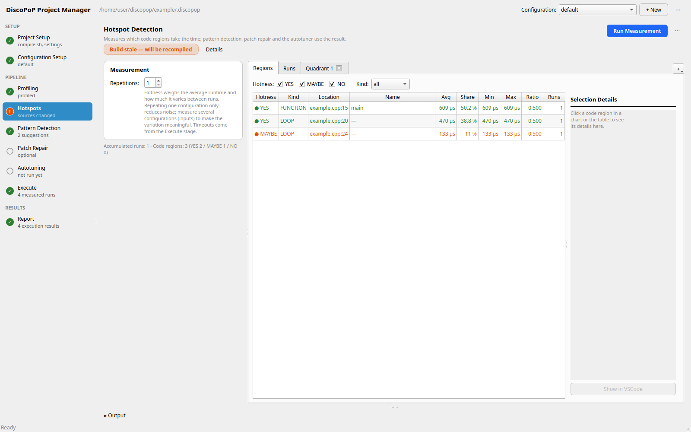
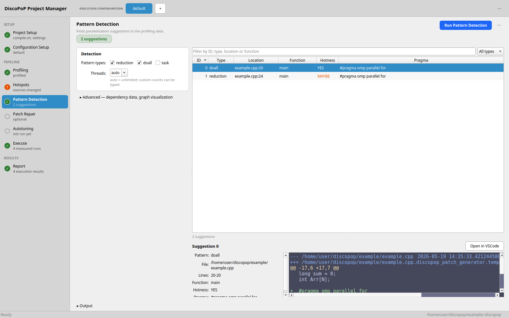

# GUI walk-through
This walk-through takes the example program from a first configuration to an autotuned, parallelized version with the graphical user interface `discopop_gui`. Each stage of the workflow sidebar runs the matching DiscoPoP tool for you; the same steps on the command line are shown in [Project manager on the command line](project_manager_cli.md).

The labels below are taken from the source code of the GUI (`library/discopop_library/ProjectManager/qt_gui`, the default Qt version).

{: .note }
The screenshots are placeholders; they will be replaced by real ones.

## Prerequisites
- DiscoPoP is [installed](../setup/discopop.md), the virtual environment is active, and a display is available.
- Work on a copy of the example: `cp -r example /tmp/dp_example`.

## Step 1: Start the GUI
Start the GUI in the project directory, or select the project with `-p`:

```bash
cd /tmp/dp_example
discopop_gui
```

`discopop_project_manager --gui` does the same. If the project has no `.discopop/project/configs` folder yet, the GUI creates it and shows a message, "Project Initialized". The window "DiscoPoP Project Manager" opens.



The header bar has the **Configuration:** selector, the buttons "+ New" and the "⋯" menu, and shows the path of the `.discopop` folder. The left column is the workflow sidebar with the stages, grouped into "Project" (Setup, Configure), "Pipeline" (Profiling, Hotspots, Pattern Detection, Patch Repair, Autotuning, Execute) and "Results" (Report). Each stage shows a badge (✓ done, ! stale, ○ not run yet, 🔒 locked) and a line of detail. The selected stage is shown on the right, and the output of all jobs is in the output pane at the bottom.

## Step 2: Create a configuration with the wizard
If the project has no real configuration yet, the "Configuration Assistant" opens on its own. Its steps are:

1. **Welcome**: an overview of the steps.
2. **Write Permissions Check**: tells whether DiscoPoP can copy the project into its parent folder. Without write access, executions are limited to the "in-place" mode.
3. **Compilation Script**: edit `compile.sh`. It is executed from the project root and has to use `$CC`/`$CXX` and `$CFLAGS`/`$CXXFLAGS`. For the example, replace the placeholder with `$CXX $CXXFLAGS example.cpp -o prog`.
4. **Compilation Settings**: the fields "C Compiler (CC)", "C++ Compiler (CXX)", "C Flags (CFLAGS)" and "C++ Flags (CXXFLAGS)". The defaults are `clang` and `clang++`.
5. **Test Compilation**: click "Run Test Compilation"; the status shows "Success" or "Failed" and the output appears below.
6. **Derived Settings**: review the settings DiscoPoP derives for the other modes, in the sub-tabs `dp_settings.json`, `hd_settings.json` and `par_settings.json`.
7. **Execution Script**: enter a "Configuration Name" (default `default`) and the `execute.sh`. For the example: `./prog`.
8. **Validation Script**: optional `validate.sh` (checks the program output; a run counts as correct only if `execute.sh` and `validate.sh` both succeed) and `compile_validate.sh` (only if validation needs another build). Leave both empty for the example.

"Next >" moves on, "< Back" goes back, "Cancel" asks for confirmation, "Finish" creates the configuration, selects it and opens the Profiling stage, the first one of the pipeline.


You can edit the wizard's results later: the stage **Setup** at the top of the sidebar shows `compile.sh` and the settings files, with the buttons "Save (Ctrl+S)", "Test Compilation" (its output appears in the output pane) and "Derive" (derives the settings of the other modes from `seq_settings.json`). "+ New" next to the **Configuration:** selector adds a further configuration; its **⋯** menu offers "Copy…", "Rename…", "New with wizard…" and "Delete…" for the selected one.

## Step 3: Edit the scripts
The stage **Configure** shows the files of the selected configuration in the sub-tabs `execute.sh`, `compile.sh (override)`, `validate.sh` and `compile_validate.sh (override)`. "Help" explains each script; "Add Override" and "Add validate.sh" create the optional ones. Save with "Save (Ctrl+S)".



The box **Execution time** below `execute.sh` sets what is measured. Off (default), the wall clock time of `execute.sh` is used. If your program prints its own time, tick "Read the execution time from the program's console output" and enter a regular expression whose first capture group holds the value, e.g. `Total time:\s*([0-9.]+)`. "Test" matches the pattern against the output of the last recorded run and shows "Matched in the last recorded run: ... s" or a failure. The setting is stored per configuration; see [Project manager](../tools/Project_manager.md).

The example prints no time, so keep the default.

## Step 4: Execute
Open the stage **Execute** (the last one of the pipeline).



| Card | Settings |
|---|---|
| Modes | "Sequential (seq)", "DiscoPoP Instrumented (dp)", "Hotspot Detection (hd)", "Parallel (par)". A mode is selectable once its settings file, the compile script and `execute.sh` exist. |
| Run | "Threads", "Repetitions" (the median is reported; only seq and par are repeated), "Label prefix" |
| Apply suggestions | "None (apply no suggestions)", "Apply manually selected suggestions" (select ids, "Browse / Edit →" opens the patches), "Apply autotuner-selected suggestions" |
| Advanced (collapsed) | "Execution timeout (s)", "Compilation timeout (s)", "Validation timeout (s)"; 3600 by default, 0 disables. "Log level"; "Execute in-place (skip project copy)"; "Skip cleanup (keep project copies)" |

It measures the configuration, with or without the suggestions found by the later steps. Measure the original program first: select `seq`, `dp`, `hd` and `par` and click "Run". The output pane shows the compilations and runs; the button turns into "■ Stop" while the run lasts, and cancels it.

## Step 5: Profiling
Open the stage **Profiling** and click "Profile for Pattern Detection". It compiles and runs the configuration in `dp` mode in place, which creates the profiling data that the Pattern Detection stage needs (runs of the `dp` mode in a project copy delete their profiling data with the copy). The card "Profiling data" shows when the last profiling run happened; "Advanced" holds the timeouts. The button turns into "■ Stop" while the run lasts; Profiling and Execute do not run at the same time.

## Step 6: Report
The stage **Report** shows all stored measurements.



- The tab "Table" lists Config, Script, Setting, Label, Applied Suggestions, Not Applied, Threads, Status, Time, Speedup and Efficiency. Missing values are shown as "—", and applied suggestions as their IDs.
- The "+" button adds charts: "Trade-off scatter", "Thread scaling", "Speedup / efficiency bars" and "Runtime bars". Click a point or bar to see its details in the bar at the side.
- "Generate PDF Report" and "View Report PDF" create and open `full_report.pdf` (written to `.discopop/project/reports/<timestamp>/`); "Reload" refreshes the view.
- The "⋯" menu offers "Reset Execution Results…", which deletes the measurements and reports, and "Reset Project…", which deletes everything in `.discopop` except the configuration files. Both ask for confirmation.

## Step 7: Hotspot detection (optional)
The stage **Hotspots** measures which code regions take the most time. Pattern detection and the hotspot-guided autotuning use the result.



Click "Run Measurement" with the "Repetitions" set in the column next to the tabs. It instruments the configuration in `hd` mode (if the build is not current), runs it and records a run. The status chip shows the build state, and the column shows the accumulated runs and the number of code regions classified YES / MAYBE / NO. The "⋯" menu offers "Re-instrument" (rebuilds), "Re-run Analysis" (analyzes the recorded runs again) and "Clear Measurements…" (deletes them).

The hotness of a region combines its average runtime with how strongly the runtime varies between runs. With a single run every ratio is 0.5, so measure a second configuration with another input size and click "Run Measurement" again for a meaningful result. The tabs "Runs" and "Regions" list the recorded runs and the regions (Hotness, Kind, Location, Name, Avg, Share, Min, Max, Ratio, Runs). The "+" button adds the charts "Hotness quadrant", "Top-N runtime bars" and "Per-region run profile". "Show in VSCode" in the detail bar opens a region in VS Code, if the `code` command is available.

For the example, which has a single configuration and runs only a few milliseconds, you can skip this step.

## Step 8: Pattern detection
Open the stage **Pattern Detection**. It is enabled after profiling data exists in `.discopop/profiler`. Without it, the stage is locked and "Go to Profiling" opens the stage that creates it. Without hotspot results, a card "Hotspots" suggests to run the hotspot detection first ("Go to Hotspot Detection").



- **Pattern Types**: `reduction` and `doall` are selected, `task` (experimental) is not.
- **Threads**: `auto` or a number.
- In "Advanced", **Dependency Data**: "default (full states)" or "no_states (states ignored)".
- In "Advanced", "Show graph visualization" runs the explorer with `--visualize`, which opens the graphs in a window of its own; the GUI stays responsive meanwhile. (The Tk version runs the explorer inside the GUI instead and shows the graphs on the sub-tab "Graph Visualization".)

Click "Run Pattern Detection". The output of the [explorer](../tools/Explorer.md) appears in the output pane. Afterwards the stage shows the suggestions as a table with the columns ID, Type, Location, Function, Hotness and Pragma (the chip shows their number, or "No suggestions found"). Select a row to see its details and its patch with the changes highlighted on the right. For the example you see suggestion 0 (`#pragma omp parallel for firstprivate(N)`) and 1 (`... reduction(+:sum)`). You can edit a patch and save it with "Save File" in the window "Browse Parallelization Suggestions" (opened with "Browse / Edit →"). "Open in VSCode" opens the source file of the selected suggestion; "Show suggestions in VSCode" in the "⋯" menu opens the project in VS Code for the [extension](walk_through_vscode.md).

To select suggestions, use the selectors that appear in the Execute and Autotuning stages: tables with a check box per suggestion (ID, Type, Location, Hotness), with "Select all"/"Deselect all" and an entry "Select IDs" that takes lists and ranges such as `1,3,5-8`.

## Step 9: Patch repair (optional)
Some patches do not compile in a real project. The stage **Patch Repair** asks a large language model to fix them; see [Patch repair](../tools/Patch_repair.md). It is not needed for the example.


Choose the "Hotspot Types" to consider (YES, MAYBE, NO; NO is off by default) in the card "Settings", the "LLM Agent" ("Backend", "Model"), restrict the "Suggestion Scope", tick "Dry run (do not modify the patches)" to leave the patches as they are, and, in "Advanced", set the "Agent timeout (s)", the "Prompts / retries" and the log level. Then click "Run Patch Repair". The result appears in the tabs "Results" (one row per suggestion: Repaired, Compiles, Not repaired, Patch not applicable, ...) and "Patch" (the patch before and after the repair). The chip summarizes the run; its "Details" toggle shows the rest.

## Step 10: Autotuning
The stage **Autotuning** measures which suggestions, or which combination of them, really speed the program up.


- In the card "Settings": "Threads", "Repetitions" (runs per candidate; the median decides), "Hotspot types" (YES by default) and the "Algorithm": "No combination (measure only)", "Linear combination", "Evolutionary combination", "Greedy combination", "Coordinate descent combination" and "Hotspot-guided region descent" (default; needs hotspot results, a red hint tells when they are missing).
- In the card "Suggestion Selection": "Search for best combination" (with the suggestions the algorithm may explore) or "Evaluate a specific combination" (apply the chosen ids together and compare them to the baseline).
- In "Advanced": "Log Level".

For the example, choose "No combination (measure only)", which measures each suggestion alone, and click "Run Autotuning". The live plot shows the candidates as they are measured, the output pane shows the output of `discopop_auto_tuner`, and the chip shows the winner as "Best combination: ...". The status bar reports "Autotuning completed successfully". The example runs for milliseconds, so expect a speedup below 1; use a realistic workload for a real result.

To apply the result, go to the Execute stage, select "Apply autotuner-selected suggestions" and run the `par` mode: the suggestions are applied in the project copy that is executed. The Report stage then shows the speedup. To change your sources permanently, use the [patch applicator](../tools/Patch_applicator.md).

## Where to go next
- [GUI](../tools/GUI.md) describes each stage in detail.
- [Project manager](../tools/Project_manager.md) and [Autotuner](../tools/Autotuner.md) explain the underlying tools.
