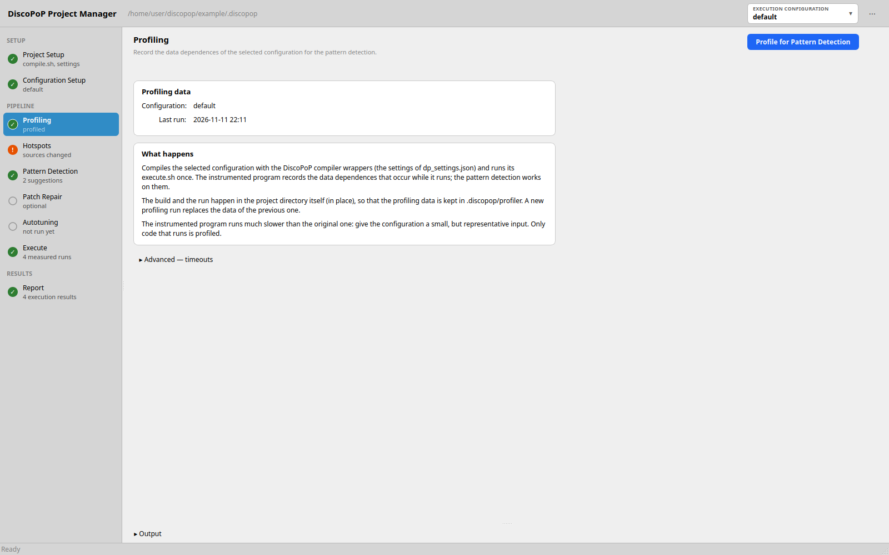
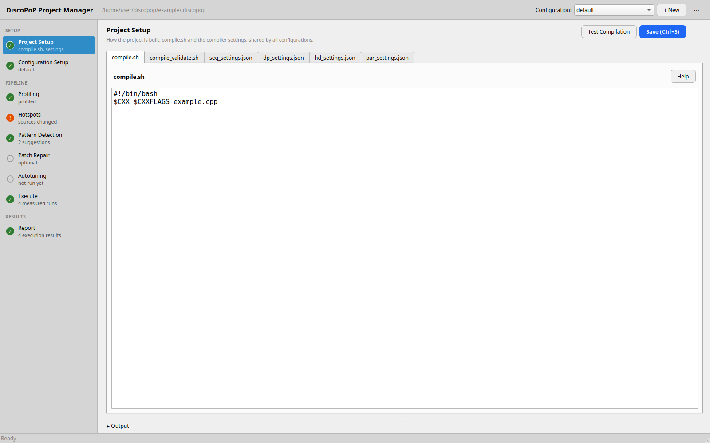
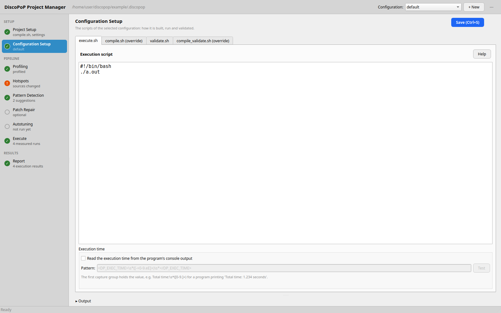
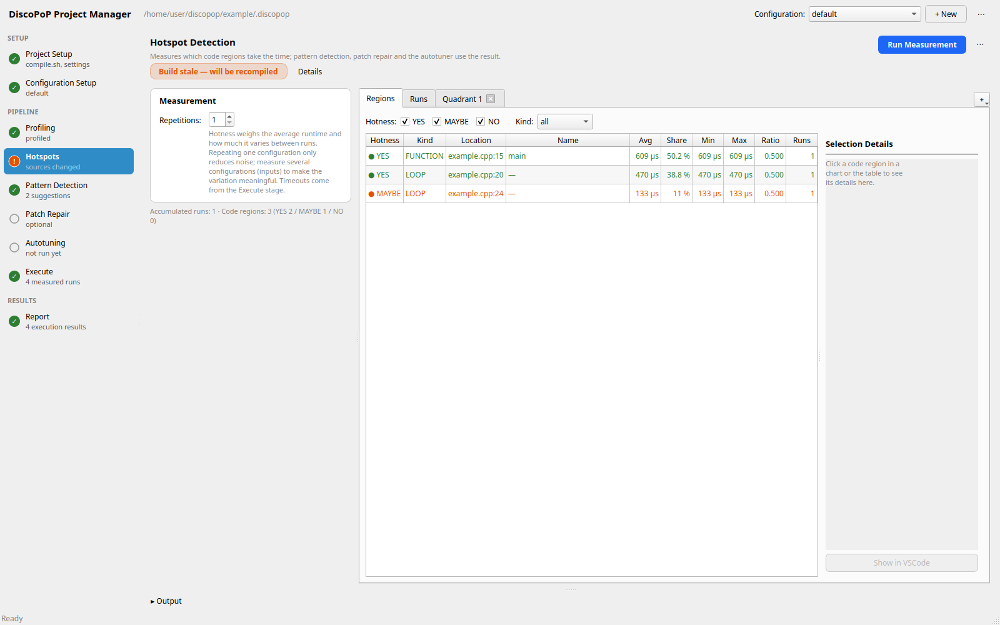
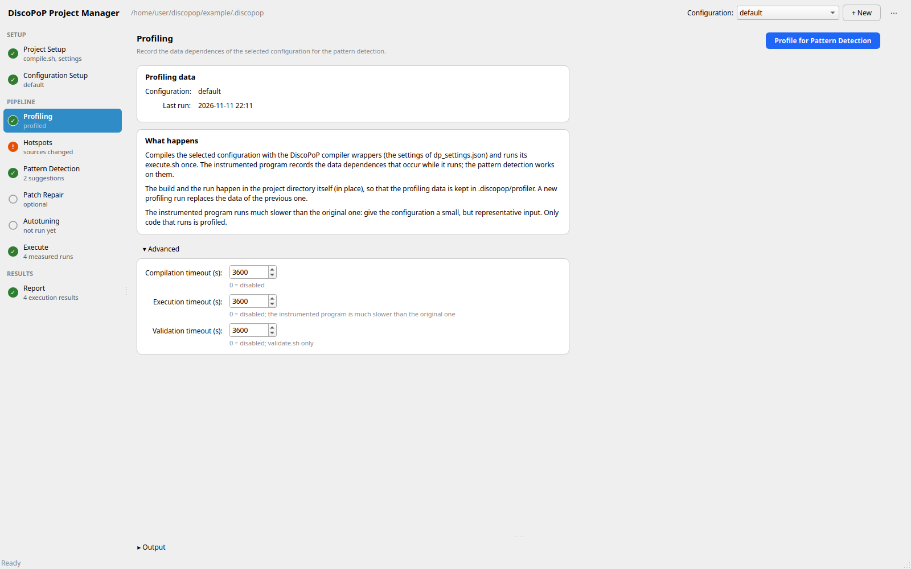
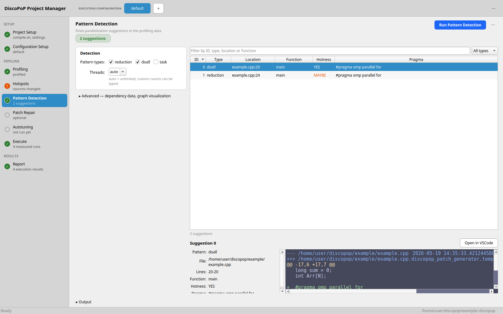
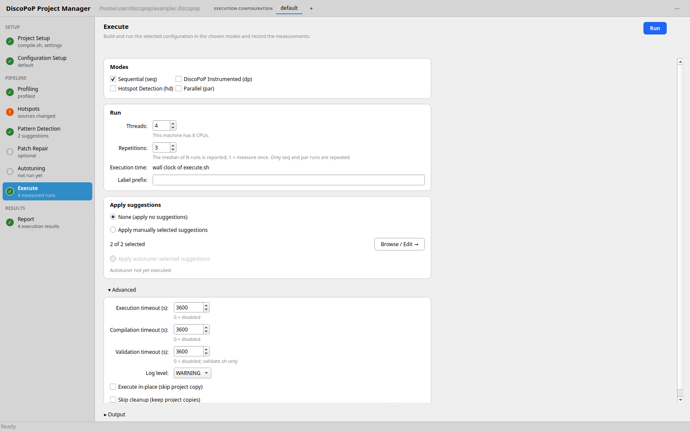
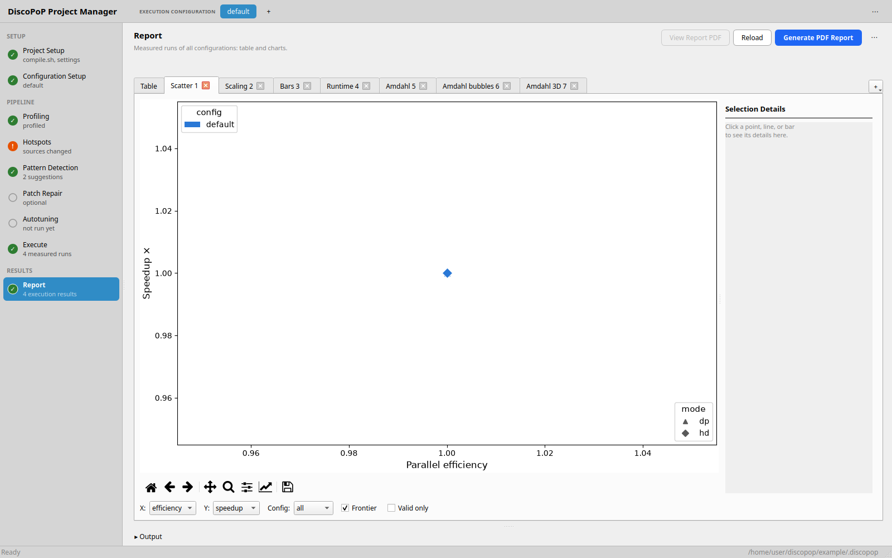

# Graphical user interface
`discopop_gui` opens a desktop window around the [project manager](Project_manager.md). It guides you from a first compile and execute script to measurements, hotspots, pattern detection, repair of generated patches and empirical autotuning. Each stage of the workflow sidebar runs the matching DiscoPoP tool for you and shows its result. Everything the GUI does is also available on the command line and through the [MCP server](MCP_server.md).

For a guided example, see the [GUI walk-through](../examples/walk_through_gui.md).

## Starting the GUI
Start the GUI in the root directory of your project:

```bash
cd <your project>
discopop_gui
```

| Command | Effect |
|---|---|
| `discopop_gui` | Opens the GUI for the project in the current directory |
| `discopop_gui -p <dir>` | Opens the GUI for the project in `<dir>` |
| `discopop_project_manager --gui` | Same as `discopop_gui` |
| `discopop_gui --gui-toolkit tk` | Opens the old Tk version of the GUI (see below) |

`discopop_gui` accepts the arguments of `discopop_project_manager`, but only `-p/--project` and the logging options matter for the GUI. A `.discopop` directory is created in the project if it does not exist yet; you do not need `--init`.

The GUI is being moved from Tk to Qt (PySide6). Both versions offer the same functions; the Qt version is the default, `--gui-toolkit tk` selects the Tk version until it is removed. The Tk version needs `tkinter` (Debian/Ubuntu: `python3-tk`), the Qt version comes with its Python package (`PySide6-Essentials`, a dependency of DiscoPoP); both need a display. Without a display (`$DISPLAY` and `$WAYLAND_DISPLAY` unset), the command prints

```text
ERROR: this command opens a graphical window, but no display is available (neither $DISPLAY nor $WAYLAND_DISPLAY is set).
-> For non-interactive use, see: discopop_project_manager --help
```

and exits with code 1. On such a machine, use the [project manager](Project_manager.md) or the [MCP server](MCP_server.md).

On a remote machine, e.g. an HPC login node, the GUI works over X forwarding (`ssh -X`). The Qt version responds noticeably faster there than the Tk version: it draws the window locally and sends the changed pixels, while Tk needs many round trips to the X server. If the Qt version reports that it cannot load the platform plugin "xcb", the remote machine lacks X libraries (usually `libxcb-cursor0`); `QT_DEBUG_PLUGINS=1` names the missing one.

{: .note }
Up to DiscoPoP 5.0, the bare `discopop` command opened the GUI. It is now the command line project manager.

## Window layout


The window has a workflow sidebar, the stage that is selected and an output pane. The sidebar and the status line form the frame of the window, in a darker shade than the page of the stage. The colors follow the light or dark color scheme of the desktop; **◐ Theme** at the bottom of the sidebar switches to *Light* (gray pages and off-white views, with more contrast than most light desktop schemes) or *Dark* (and back to *System*), and the choice is kept for the next start. The charts stay light. The status line at the bottom shows messages on the left and the path of the `.discopop` directory on the right (shortened in the middle; its tooltip shows all of it).

- **Configuration selector** (at the top of the stages that work on the selected configuration: *Configuration Setup*, *Profiling*, *Patch Repair*, *Autotuning* and *Execute*; the other stages do not show it): the execution configurations of the project (the directories below `.discopop/project/configs/`) as tabs; the selected one is filled in the highlight color like the selected stage of the sidebar. A click on a tab switches to it, and the stage stays in front. The selection is the same on all these stages. When there are more configurations than fit, arrows at the end of the tabs (or the mouse wheel over them) scroll them. **+** creates an empty configuration (you enter a name; its `execute.sh` is a placeholder you have to edit). The **⋯** menu at the right end offers *New Configuration…*, *New with Wizard…*, *Copy*, *Rename* and *Delete* of the selected configuration; right-clicking a tab offers *Copy*, *Rename* and *Delete* of its configuration.
- **Workflow sidebar** (left): the stages of the pipeline, grouped into three sections:
  - **Setup**: *Project Setup*, the build shared by all configurations, and *Configuration Setup*, the scripts of the selected configuration.
  - **Pipeline**: *Hotspots*, *Profiling*, *Pattern Detection*, *Patch Repair*, *Autotuning*, *Execute*.
  - **Results**: *Report*.

  Each stage shows a badge and a line of detail, for example "3 suggestions" or "sources changed". The badges are: ✓ done; ! stale, the result is out of date (for example "sources changed", or "profiling data newer than the results"); ○ not run yet; 🔒 locked, the detail line says what is missing (for example "needs profiling data" for *Autotuning*). Locked stages can still be opened: *Pattern Detection* explains what is missing and offers **Go to Profiling**; *Autotuning* shows a warning with the missing prerequisite (profiling data or parallelization suggestions) and a button to the stage that creates it, and **Run Autotuning** is unavailable until then.
- **Stage** (right): the stage that is selected.
- **Output pane** (bottom): the output of all jobs, see [Output pane](#output-pane).

Every stage has the same header: its title, a one-line description, a status chip (a colored label; some chips have a **Details** toggle for the longer explanation) and its actions at the top right. The primary action, for example **Run**, is one button that turns into **■ Stop** while the job runs. Rare or destructive actions are in a **⋯** menu of the stage. Settings are grouped in cards; settings that are rarely changed are in a collapsed **Advanced** section.

The Tk version (`--gui-toolkit tk`) keeps the old layout: the configuration list on the left with **+ New** and **Edit Compilation**, and the tabs *Editor*, *Execute*, *Report*, *Hotspot Detection*, *Pattern Detection*, *Patch Repair* and *Autotuning* on the right. The functions of the tabs are the same as those of the stages described below; the *Project Setup* stage is the window opened by **Edit Compilation**, the *Configuration Setup* stage is the *Editor* tab, the *Profiling* stage is the button **Prepare Pattern Detection** of the *Execute* tab.

The stages for later steps explain which prerequisite is missing: the detail line in the sidebar, and on mouse over. For example, *Pattern Detection* needs profiling data and *Autotuning* needs pattern detection results.

### Output pane
The output of all jobs is shown in one pane below the stages, with one tab per stage. Collapsed, the pane is one line that shows the last line any job wrote. It opens when a job starts; the toggle expands and collapses it, and **Clear** empties the shown output. The stages themselves have no consoles.

## Configuration assistant (wizard)


When the project has no usable configuration, the GUI opens the *Configuration Assistant* at start. It has eight steps:

1. **Welcome**
2. **Write Permissions Check**: the project is copied to a sibling directory for every run. Without write access to the parent directory, only in-place execution is possible.
3. **Compilation Script**: the shared `compile.sh`. Use `$CC`/`$CXX` and `$CFLAGS`/`$CXXFLAGS` for all compile commands; the script must exit with `0`. The assistant asks for confirmation if it contains neither `$CC` nor `$CXX`.
4. **Compilation Settings**: `CC`, `CXX`, `CFLAGS` and `CXXFLAGS` of the sequential build (`seq_settings.json`).
5. **Test Compilation**: **Run Test Compilation** builds the project with the script and settings and shows the status and the output.
6. **Derived Settings**: shows `dp_settings.json`, `hd_settings.json` and `par_settings.json`, which are derived from the sequential settings. You can edit them before accepting.
7. **Execution Script**: the name of the configuration (default `default`) and its `execute.sh`, a minimal run of the program.
8. **Validation Script**: optional `validate.sh` and, if validation needs another build, `compile_validate.sh`.

After **Finish**, the new configuration is selected and the *Profiling* stage, the first one of the pipeline, opens. See [Project manager](Project_manager.md) for the meaning of the scripts and settings.

## Project Setup


The *Project Setup* stage edits the files shared by all configurations, each in its own tab: `compile.sh`, `compile_validate.sh`, `seq_settings.json`, `dp_settings.json`, `hd_settings.json` and `par_settings.json`. Unsaved changes mark the stage "Project Setup *" in the sidebar.

- **Save (Ctrl+S)** writes the files.
- **Test Compilation** (on the `compile.sh` tab) builds the project with the current script and settings, without recording a result. The output appears in the output pane, the outcome in the status chip.
- **Derive** (on the `seq_settings.json` tab) creates `dp_settings.json`, `hd_settings.json` and `par_settings.json` from `seq_settings.json`: `discopop_cc`/`discopop_cxx` for `dp`, `discopop_hotspot_cc`/`discopop_hotspot_cxx` and `-fopenmp` for `hd`, `-fopenmp` for `par`.
- The shared `compile_validate.sh` is optional (**Add** / **Remove**).
- The **Danger zone** below the files, framed in red, holds the resets, as red-outlined buttons. Both ask for confirmation and are disabled while a run is in progress:
  - **Reset Execution Results…** deletes the measured runs of all configurations and the reports.
  - **Reset Project…** deletes everything below `.discopop` except the configurations, `compile.sh` and the settings: profiling data, suggestions, hotspot measurements, autotuning results, measured runs and reports.

Files without unsaved changes are read again when the stage is shown, so the files written by the configuration assistant or by another program appear.

{: .note }
The GUI does not derive the settings files again when it executes a configuration, so your edits of them are kept. The command line project manager overwrites them from `seq_settings.json` on every run.

## Configuration Setup


The *Configuration Setup* stage edits the scripts of the selected configuration. Save with **Save (Ctrl+S)**. Every sub-tab has a **Help** button. The sub-tabs are:

| Sub-tab | Content |
|---|---|
| `execute.sh` | The timed run of the program. Contains the *Execution time* setting (see below). |
| `compile.sh (override)` | A build script used instead of the shared `compile.sh` for this configuration only. **Add Override** creates it, the button then removes it. |
| `validate.sh` | Optional correctness check, run separately from `execute.sh`. **Add validate.sh** creates it. |
| `compile_validate.sh (override)` | Optional build used for `validate.sh` only. |

The scripts are executed with the project root as working directory and with the environment variables described in [Project manager](Project_manager.md#configuration-directory).

### Execution time
By default, the runtime of `execute.sh` is its wall clock time. Check *Read the execution time from the program's console output* to measure the time the program prints itself instead. *Pattern* is a regular expression whose first capture group holds the value; the default searches for `<DP_EXEC_TIME>1.234</DP_EXEC_TIME>`. **Test** applies the pattern to the output of the last recorded run without executing anything. The setting is stored in `execution_time.json` next to `execute.sh`. See [Measured runtime](Project_manager.md#measured-runtime).

## Hotspots


The stage measures which loops and functions dominate the runtime. See [Hotspot detection](Hotspot_detection.md) for the method. Its tabs are *Runs*, *Regions* and the plot tabs added with **+** (*Hotness quadrant*, *Top-N runtime bars*, *Per-region run profile*). The measurement settings, *Repetitions*, are a column next to these tabs; the column also shows the accumulated runs and the number of code regions per hotness.

The card *Execution configurations* lists the configurations of the project with check boxes (**All** / **None**) and the status of each: how many runs it has, or, during and after a measurement, *queued*, *measuring*, *measured*, *failed* (with the reason) or *stopped*. At first only the selected configuration (see the configuration selector of the other stages) is checked, and the check follows that selection; once you change a check box yourself, your choice stays (a configuration created later starts unchecked).

**Run Measurements** (**■ Stop** while it runs) measures the checked configurations one after another, in `hd` mode in place: it builds the program with `discopop_hotspot_cc`/`discopop_hotspot_cxx` when the build does not serve the configuration (missing, outdated, or another compile script), executes it *Repetitions* times, and at the end calls `discopop_hotspot_analyzer` once on all accumulated runs. A failing configuration does not stop the others; **■ Stop** ends the whole batch, and the configurations not measured yet are marked *stopped*. The status line sums up the batch, e.g. "1 measured, 1 failed ✗". Repeating one configuration only reduces noise. To make the hotness classification meaningful, measure several configurations with different input sizes; the runs of all configurations are combined. The status chip shows the state of the build of the first checked configuration, and the progress ("Measuring 2 of 3: B") while a batch runs.

The **⋯** menu offers the following actions:

| Action | Effect |
|---|---|
| Re-instrument | Build the hotspot-instrumented program again |
| Re-run Analysis | Run the analyzer again on the accumulated runs |
| Clear Measurements… | Delete the accumulated runs |

*Runs* lists every recorded run (runs recorded elsewhere, for example in the Execute stage, by the command line or by the MCP server, are marked `(external)`). *Regions* lists the code regions with hotness (`YES`, `MAYBE`, `NO`), kind, location, average, share, minimum, maximum, ratio and number of runs, with filters for hotness and kind. **Show in VSCode** in the detail bar of a region opens it in VS Code.

Results are stored in `.discopop/hotspot_detection/` (`Hotspots.json` and the run log `measurement_runs.json`).

## Profiling


The *Profiling* stage compiles the selected configuration with the DiscoPoP compiler wrappers (`dp_settings.json`) and runs its `execute.sh` once, in place, i.e. in the project directory itself. The profiler records the data dependences that occur in this run; they are kept in `.discopop/profiler`, and the *Pattern Detection* stage works on them. A new profiling run replaces the data of the previous one.

Its header holds **Profile for Pattern Detection** (**■ Stop** while it runs). The cards show the selected configuration and the time of the last profiling run (or which profiling files are missing), and explain the run. The instrumented program runs much slower than the original, so give the configuration a small, but representative input. *Advanced* (collapsed) holds the timeouts for compilation, execution and validation in seconds (0 = disabled).

Without `compile.sh`, `execute.sh` or `dp_settings.json`, the stage says what is missing; **Go to Project Setup** opens the *Project Setup* stage. The *Profiling* and *Execute* stages do not run at the same time.

## Pattern Detection


The stage runs `discopop_explorer` in the `.discopop` directory. It needs the profiling data of a `dp` run (run the *Profiling* stage first). Without profiling data, the stage says what is missing and offers **Go to Profiling**.

The settings are cards:

| Card | Setting |
|---|---|
| Hotspots | Shown while there are no hotspot results: a hint and **Go to Hotspots**. The Explorer restricts its analysis to the hot parts of the program when `Hotspots.json` exists. |
| Detection | Pattern Types: `reduction` and `doall` (default); `task` is experimental. Threads: worker processes of the Explorer (`-j`); `auto` = unlimited. |
| Advanced (collapsed) | Dependency Data: `default (full states)` or `no_states (states ignored)`, i.e. `--ignore-dependency-states`. *Show graph visualization*: Tk version: runs the Explorer inside the GUI process and shows its graphs in the *Graph Visualization* tab; the window is unresponsive while it runs. Qt version: runs `discopop_explorer --visualize`, which shows the graphs in a window of its own (needs the package `discopop-gui`); the GUI stays responsive and *Stop* works. |

**Run Pattern Detection** (**■ Stop** while it runs) starts the detection. Its **⋯** menu offers **Show suggestions in VSCode** (the `code` command must be on your `PATH`) and **Browse / edit patches…**, a window in which the patch files of the suggestions can be edited.

The stage shows its results itself. The table lists the suggestions with ID, type, location, function, hotness and pragma; a filter line and a type filter narrow the rows, and the columns can be sorted. For the selected suggestion, the details and the patch are shown below the table, the patch as a colored diff; **Open in VSCode** opens the source file at the loop of the suggestion. The chip shows the number of suggestions, or that none were found. The patch files are in `.discopop/patch_generator/`.

Results are the files described in [Explorer](Explorer.md): `explorer/patterns.json` and the patches in `patch_generator/`.

## Patch Repair


The stage runs [`discopop_patch_repair`](Patch_repair.md): an LLM agent repairs generated patches that do not compile. Its cards are *Settings* (the hotspot types, `NO` is off by default, and *Dry run (do not modify the patches)*), *LLM Agent* (backend and model) and *Suggestion Scope*. The collapsed *Advanced* section holds the agent timeout, the number of prompts and retries and the log level. The chip summarizes the outcome of the last run; *Details* shows the rest.

The right side shows *Results* (one row per suggestion) and *Patch*, the patch of the selected suggestion before and after the repair, as a diff.

## Autotuning


The stage runs [`discopop_auto_tuner`](Autotuner.md) for the selected configuration. It needs the output of pattern detection and the `dp` and `hd` settings. Without profiling data or parallelization suggestions, the stage shows a warning that names the missing prerequisite, with **Go to Profiling** resp. **Go to Pattern Detection**.

| Card | Setting |
|---|---|
| Settings | `Algorithm`: `0` to `6`; the GUI preselects `6`, *Hotspot-guided region descent*, which needs hotspot results (the stage warns if they are missing). The command line default is `0`. `Threads`: `OMP_NUM_THREADS` of the measurements (`auto` = CPU count / 2). `Repetitions`: runs per candidate (default 1). `Hotspot types`: `YES` (default), `MAYBE`, `NO`. |
| Suggestion Selection | *Search for best combination* (optionally restricted to a subset) or *Evaluate a specific combination*. **Browse / Edit →** opens the list of suggestions. |
| Advanced (collapsed) | Log level |

The *Live Plot* shows every measured configuration while the tuner runs; its output is in the output pane. The stage does not apply the result: in the *Execute* stage, choose *Apply autotuner-selected suggestions* and run the `par` mode, or apply the suggestions to your sources with the [patch applicator](Patch_applicator.md).

## Execute


The *Execute* stage compiles and runs the selected configuration, as `discopop_project_manager -x` does, and records the measurements. Its header holds **Run** (**■ Stop** while it runs). It is the last stage of the pipeline: it measures the configurations with or without the suggestions of the stages before it.

| Card | Setting |
|---|---|
| Modes | `seq` (sequential), `dp` (DiscoPoP instrumented), `hd` (hotspot detection), `par` (parallel). A mode is available when its settings file, the compile script and `execute.sh` exist. |
| Run | Thread count (`OMP_NUM_THREADS`), repetitions (median of N, `seq` and `par` only), label prefix, and a summary of the execution time setting of the *Configuration Setup* stage |
| Apply suggestions | None, manually selected suggestions (**Browse / Edit →**), or the suggestions selected by the autotuner |
| Advanced (collapsed) | Timeouts for execution, compilation and validation in seconds (0 = disabled), log level, *Execute in-place (skip project copy)*, *Skip cleanup (keep project copies)* |

The profiling data for the pattern detection is created by the [Profiling](#profiling) stage. Runs of the `dp` mode in a project copy delete their profiling data with the copy.

{: .warning }
In-place execution together with applied suggestions modifies your project directory. The GUI asks for confirmation.

Results are stored in `.discopop/project/execution_results.json`.

## Report


The *Report* stage shows all recorded measurements. The *Table* tab lists configuration, script, setting, label, applied and not applied suggestions, threads, status, time, speedup and efficiency; speedup is relative to the `seq` run of the same script. Times have their units, missing values are shown as "—", and applied suggestions are listed by their IDs. With the **+** button you add plots: *Trade-off scatter*, *Thread scaling*, *Speedup / efficiency bars* and *Runtime bars*. Click a point or bar to see its details.

- **Generate PDF Report** and **View Report PDF** create and open `.discopop/project/reports/<timestamp>/full_report.pdf` (the folder also holds `report.csv` and single PDFs). Viewing uses `xdg-open`.
- To delete the measured runs and the reports, use **Reset Execution Results…** in the *Danger zone* of the [Project Setup](#project-setup) stage.
- **Reload** re-reads the results.

## What the stages run

| Stage | Runs |
|---|---|
| Project Setup, Configuration Setup, Profiling, Execute, Report | The code of [`discopop_project_manager`](Project_manager.md) (in the GUI process) |
| Hotspots | The `hd` mode of the project manager, then `discopop_hotspot_analyzer` |
| Pattern Detection | `discopop_explorer` (subprocess; in the Tk version in process with graph visualization) |
| Patch Repair | `python -m discopop_library.PatchRepair` (`discopop_patch_repair`) as a subprocess |
| Autotuning | `python -m discopop_library.EmpiricalAutotuning` (`discopop_auto_tuner`) as a subprocess |

## Where results are stored
Everything is stored in the `.discopop` directory of the project:

| Path | Content |
|---|---|
| `project/configs/` | Configurations, shared scripts and settings files |
| `project/execution_results.json`, `project/reports/` | Measurements and reports |
| `profiler/` | Profiling data of the `dp` mode |
| `hotspot_detection/` | Hotspot runs and `Hotspots.json` |
| `explorer/`, `patch_generator/` | Detected patterns and patches |
| `auto_tuner/` | Results of the autotuner |
| `patch_repair/` | Results of patch repair |

## Relation to the VS Code extension and the MCP server
- The [VS Code extension](../setup/vscx.md) is an addition to the GUI. It browses (and applies) the suggestions and hotspots inside the editor. **Show Suggestions in VSCode** opens the project there. The GUI does not need the extension.
- The [MCP server](MCP_server.md) uses the same configurations below `.discopop/project`. Configurations you created in the GUI can be used by an LLM agent and the other way round.
